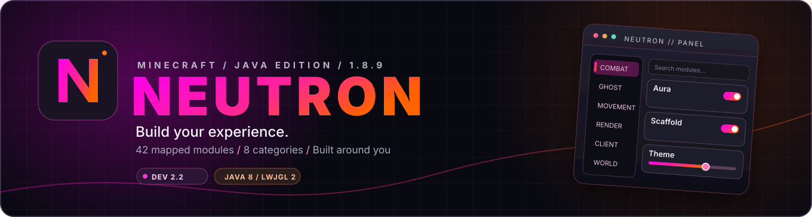
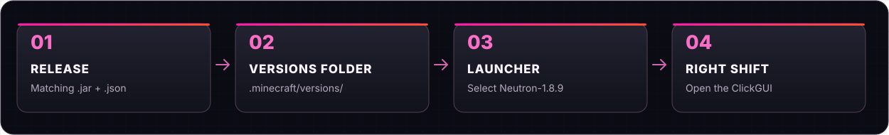
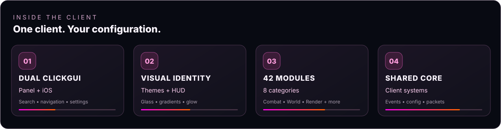
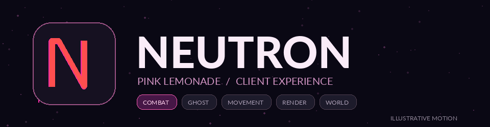
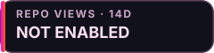
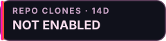
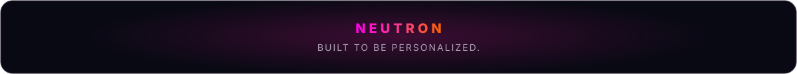

<!--
  Neutron Client — repository landing page.
  Branding is derived from the client code's default PinkLemonade theme.
  No image below is presented as a captured in-game screenshot.
-->

<div align="center">
  
</div>

# Neutron Client

**Neutron** is a customizable Minecraft **Java Edition 1.8.9** client built around modular gameplay tools, a custom combat and movement infrastructure, and a highly configurable visual experience. Switch between **Panel** and **iOS** ClickGUI layouts, personalize themes and HUDs, and explore **42 mapped modules across 8 categories**.

<div align="center">
  
  
  
  
  
  
  <a href="LICENSE"></a>
</div>

<p align="center">
  <a href="#quick-install--official-minecraft-launcher">Quick install</a> &nbsp;·&nbsp;
  <a href="#what-you-get">Features</a> &nbsp;·&nbsp;
  <a href="#module-library">Modules</a> &nbsp;·&nbsp;
  <a href="#development">Build</a> &nbsp;·&nbsp;
  <a href="#project-status">Status</a>
</p>

## Quick install · Official Minecraft Launcher

> [!IMPORTANT]
> **The JAR + JSON launcher release is not verified or published by the development evidence available for this README.** The steps below describe the intended installation procedure **once a matching, tested pair is attached to a GitHub Release**. The Maven-generated JAR is **not** yet a certified drop-in Minecraft version.

1. **Download the matching pair** from [GitHub Releases](https://github.com/YoungJibbit95/Pulsar-Client/releases) when available: `Neutron-1.8.9.jar` **and** `Neutron-1.8.9.json` (same version/build).
2. **Close Minecraft and the Launcher.** Open your `.minecraft/versions` directory:

   | OS | Folder |
   | :-- | :-- |
   | Windows | `%APPDATA%\.minecraft\versions` |
   | macOS | `~/Library/Application Support/minecraft/versions` |
   | Linux | `~/.minecraft/versions` |

3. **Create a new folder** named `Neutron-1.8.9`, then put both files inside. Folder name, JAR filename, JSON filename **and the JSON `id`** must refer to the same release version.

   ```text
   .minecraft/
   └── versions/
       └── Neutron-1.8.9/
           ├── Neutron-1.8.9.jar
           └── Neutron-1.8.9.json
   ```

4. **Open the official Minecraft Launcher**, go to **Installations → New Installation**, and select the installed Neutron version. Select a **Java 8** runtime if your launcher requires a custom Java path.
5. **Launch**, then press **Right Shift** to open Neutron's ClickGUI.

<div align="center">
  
</div>

**Installation notes:** This is a standalone **version-folder workflow**, not a Forge/Fabric `.minecraft/mods` installation. Always use a paired release; don't rename an arbitrary shaded JAR and expect it to work. Back up saves/profiles before testing a custom client, and respect individual server rules. If no release assets appear, there is **no user-installable build confirmed by this README**.

## What you get

<div align="center">
  
</div>

- **Your interface, your style.** Two ClickGUI layouts (**Panel** and **iOS**), search in the Panel UI, a themed main menu, theme presets and custom themes, and global surface settings including gradients, blur, glow, animation and liquid-glass styling.
- **HUD customization.** ArrayList, watermark, armor, session and target overlays, plus HUD position/layout controls. Availability of dragging and editing varies by widget.
- **Gameplay modules.** Combat, Ghost, Movement, Player, World and Exploit features, including Aura, AimAssist, Scaffold, AutoTool, NoSlow and packet-delay tools. Features vary in maturity; a listed module does not imply every mode has been certified.
- **Under the hood.** Shared targeting, rotation, movement correction, attack scheduling, scaffold placement, packet processing, event dispatch, settings and configuration persistence.
- **Accounts.** An in-client account library with offline accounts; Microsoft browser sign-in is implemented but requires the owner's registered application configuration and separate live validation.

<div align="center">
  
  <sub>Animated brand visualization · not an in-game screenshot or performance benchmark.</sub>
</div>

## Module library

The codebase contains **42 inventoried module classes** in the following eight categories (source inventory cross-checked against the current branch). This is a source-level catalog, **not** a guarantee that every module, configuration or game/server combination works flawlessly.

| Category | Count | Purpose |
| :-- | --: | :-- |
| **Combat** | 5 | Targeting, attack control, knockback interaction |
| **Ghost** | 7 | Lightweight combat and bridging helpers |
| **Movement** | 2 | Sprint and movement modes |
| **Player** | 6 | Inventory, tools, slots and item use |
| **World** | 2 | Bridging and placement |
| **Exploit** | 4 | Packet/timing-oriented experiments |
| **Client** | 6 | ClickGUI, themes, client settings and HUD |
| **Render** | 10 | ESP, animations and on-screen information |
| **Total** | **42** | **8 categories** |

<details>
<summary><strong>Expand the full 42-module list</strong></summary>

| Category | Modules |
| :-- | :-- |
| **Combat** | AimAssist · AntiBot · Aura · MoreKB · Velocity |
| **Ghost** | AutoHeal · AutoBridger · AutoClicker · HitDelayFix · JumpReset · Reach · WTap2 |
| **Movement** | Speed · Sprint |
| **Player** | AutoTool · FastPlace · InvManager · NoSlow · SlotHandler · Stealer |
| **World** | BridgeAssist · Scaffold |
| **Exploit** | BackTrack · LagRange · MinibloxFix · Tickbase |
| **Client** | ArrayListHUD · Client Settings · HUD · Theme · Watermark · ClickGui |
| **Render** | Animations · ArmorHUD · 2D ESP · Fullbright · GlowESP · Nametags · NoFovChange · Session Info · TargetHUD · ViewBobbing |

</details>

A more detailed [source-level technical and module reference](docs/CLIENT_TECH_REFERENCE.md) documents the module paths, UI systems, historical audit findings and interaction areas still needing validation.

### Visual system

The current source provides **19 built-in theme presets**, a custom-theme catalog, synchronized gradients across several UI surfaces, and effect controls for Gaussian/Kawase blur, glow, opacity, borders and reduced motion. Neutron's default theme is **PinkLemonade**, the magenta-to-orange accent used in this README. The two ClickGUI implementations have different component structures; appearance and interaction parity are ongoing development work.

## Technology

| Layer | Implementation |
| :-- | :-- |
| Game base | Minecraft Java Edition **1.8.9**, customized Minecraft/OptiFine paths |
| Language | **Java 8** |
| Build and packaging | **Maven / MavenMCP**, Maven Shade + Assembly |
| Graphics | **LWJGL 2**, **OpenGL**, FBO/shader-based rendering |
| Events | **Alpine 3.1.0** event bus |
| Module discovery | **Reflections 0.10.2** with module annotations |
| Data & networking | **Gson**, **Netty**, HTTP libraries |
| Logging & tests | **Log4j 2**, **JUnit 4** |

Key source areas: [`Pulsar.java`](src/main/java/me/youngjibbit/Pulsar.java) · [`core/`](src/main/java/me/youngjibbit/core/) · [`module/`](src/main/java/me/youngjibbit/module/) · [`clickgui/`](src/main/java/me/youngjibbit/clickgui/) · [`gui/`](src/main/java/me/youngjibbit/gui/) · [`theme/`](src/main/java/me/youngjibbit/theme/).

## Development

For contributors with repository access, use **Java 8** and **Maven 3.9.x**. The existing project report validated one setup with Temurin 8u482 and Maven 3.9.15.

```bash
git clone https://github.com/YoungJibbit95/Pulsar-Client.git
cd Pulsar-Client
mvn clean test
# Development artifacts only; NOT a verified launcher distribution:
mvn package
```

The documented IDE startup uses the test-source `Start` class, a separate working directory with legitimate Minecraft 1.8 assets, and the project's native test libraries. See the [original development and integration report](design/integration-final.md) before changing packaging or launch flags. Maven's current assembly/shade configuration **does not certify** the JAR/JSON launch contract.

### Account sign-in configuration

Offline accounts are available. Microsoft browser sign-in uses OAuth authorization code + PKCE and a local loopback callback. To use it, register your **own** Microsoft desktop application and configure `PULSAR_MICROSOFT_CLIENT_ID`; live sign-in and Minecraft Services approval remain separate checks. Details: [Microsoft browser sign-in setup](design/microsoft-browser-login.md). Never commit credentials, tokens, personal game directories or local profiles.

## Repository traffic

<div align="center">
  
  &nbsp;
  
</div>

These badges are designed for **real GitHub repository traffic**, not arbitrary visitor pixels or fabricated all-time numbers. GitHub reports views/clones for a **rolling 14-day window**. Refreshing the badges requires the opt-in [traffic workflow](.github/workflows/traffic-metrics.yml) and a repository secret (`NEUTRON_TRAFFIC_TOKEN`) with **Administration: read** access. Until configured, the badges intentionally say **NOT ENABLED**. For a private repository, these metrics are meant for authorized viewers only. See [badge setup](docs/README_ASSETS.md).

## Project status

**Current source identity: `Neutron` · `Dev 2.2`.** This README is a **release-ready presentation draft**, *not* a claim that a downloadable production release is already certified.

| Area | Current evidence |
| :-- | :-- |
| Module system / UI / configs | Implemented in source; broad automated tests documented |
| Built-in visuals | Panel + iOS layouts; theme and rendering systems present |
| Standalone `JAR + JSON` installation | **Not yet end-to-end verified** |
| Fresh-machine dependency bootstrap | **Not yet validated** |
| Real-account, live-server, native-window and shaderpack QA | **Not fully established** |
| Known module completion gaps | AntiBot and Reach need more work; other interactions require QA |

Read the [integration report](design/integration-final.md) and [Minecraft source audit](design/minecraft-source-audit.md) for implementation evidence and limitations. A module being listed is not an anti-cheat compatibility, performance, uptime or server-acceptance guarantee.

## Links & legal

**[Releases](https://github.com/YoungJibbit95/Pulsar-Client/releases)** · **[Issues](https://github.com/YoungJibbit95/Pulsar-Client/issues)** · **[License](LICENSE)** · **[Development reports](design/)** · **[README asset notes](docs/README_ASSETS.md)**

Neutron is an independent third-party Minecraft client, not affiliated with or endorsed by Mojang Studios or Microsoft. Minecraft and related names are trademarks of their respective owners. Review server policies before using client modifications.

The repository contains a **GNU GPL v3** [`LICENSE`](LICENSE); third-party code, game assets and dependencies may have their own terms. A private development repository is not automatically a public source distribution.

<div align="center">
  
</div>
