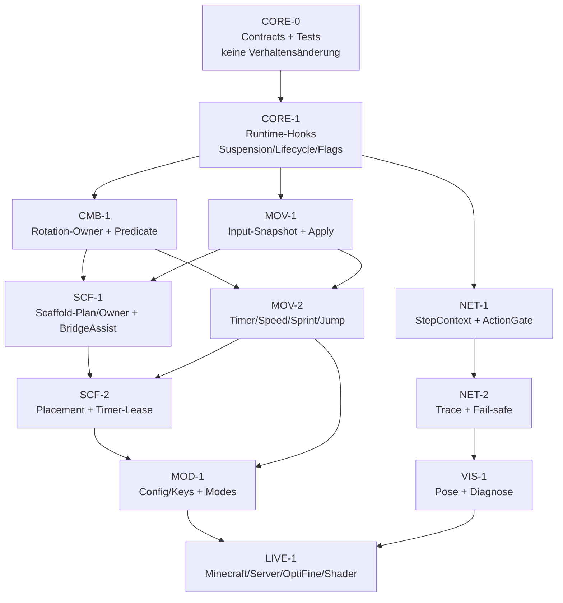

# CORE-R01 — Ownership, Entscheidungsstatus und Migrationsreihenfolge

**Status:** Architektur-/Integrationsplanung, **keine Implementierung**  
**Datum:** 2026-10-28  
**Branch/HEAD:** `prep/neutron-opencode-wave00` / `3ea55cbc34e14ad479454c6ce0d31e48e6f581fb`

---

## 1. Verbindliche Ownership-Regeln

### 1.1 Ein Schreiber pro Zustand

| Zustand | Schreiber | Request-API | Consumer | Kontrolle |
|---|---|---|---|---|
| `timerSpeed` | `TimerArbiter` | `request/renew/release` | `Timer.updateTimer`, `Tickbase` | Token, Priorität, TTL, `before/written` |
| Input-Felder | `InputResolver`/ein Adapter | `request/renew/release` | `MovementInput`, `moveFlying`, `jump` | Rohzustand + Intent, TTL |
| Sprint | `InputResolver` | `Channel.SPRINT` | `setSprinting`, C0B | physischer Stop vor Modulstart |
| Rotation | `RotationManager` | `request/requestVisible` | C03, MoveFix, Placement | bestätigter Owner + Akzeptanz |
| Angriff | `PlayerControllerMP` + `AttackScheduler` | `allowControllerAttack`/`tryAttack` | C02 | ein Controller-Angriff pro Tick |
| Platzierung | `ScaffoldPlacementService` | `place(...)` | Controller-Click | Sequenz + Tick-Budget |
| Inventar | `PlayerControllerMP` | `windowClickGuarded` | C0E | Container-/World-Validierung |
| Packet | `PacketPipeline`/`NetHandlerPlayClient` | `sendPacketTracked`/`sendPacketGuarded` | Netty | Pipeline/Context-Version |
| Config | `ConfigManager`/`Value` | `decodeConfig`, Save/Load | JSON | Version 2, Legacy-Aliase |
| Körperpose | `BodyRotationController`/VIS | Render-Snapshot | Renderer | kein Gameplay-State |

### 1.2 Was „Owner“ nicht bedeutet

- Owner ist **keine Berechtigung**, jede Tick-Aktion auszuführen. Er ist die Identität für einen Zustand.
- Owner ist **keine Garantie**, dass ein Paket vom Server akzeptiert wurde. Bei Rotation zählt nur der bestätigte C03-Frame.
- Owner ist **kein Wertvergleich**. Zwei Timer-Leases mit demselben Wert bleiben zwei Owner.
- Owner ist **keine Weltgrenze**. Jede Lease trägt `connectionGeneration`; Welt-/Session-Wechsel invalidiert sie.

### 1.3 Phasenregeln

| Ebene | Was gilt | Was nicht gilt |
|---|---|---|
| `EventUpdate` | vor der Bewegung; noch kein frischer Vanilla-Input | keine Motion-Writes als „bereits geschehen“ interpretieren |
| Input-Boundary | nach `updatePlayerMoveState`, vor `super.onLivingUpdate` | keine Paketphase |
| `EventMotion.PRE` | nach der Bewegung; vor C0B/`resolve`/C03 | keine „Bewegung dieses Ticks“ ableiten |
| `EventMotion.POST` | nach C03/`finishMotion` | keine neue Platzierungsplanung |
| `EventPacket` PRE/POST | Paketphase | keine Movement-Phase |

---

## 2. Status der W01-Entscheidungen C1–C5, M1–M7, D1–D10

Die folgende Tabelle trennt **produktlich beschlossen**, **prinzipiell beschlossen mit offenem Mechanismus** und **offen**. Eine Auditor-Empfehlung ist keine Nutzerfreigabe.

| ID | Thema | Status | CORE-R01-Konsequenz | Betroffene Bereiche |
|---|---|---|---|---|
| **C1** | PRE-Semantik / echter Pre-Movement-Hook | **OFFEN — Auditor-Empfehlung** | PRE bleibt Paketphase; `StepContext` statt neuem Hook. Kein neuer Mixin in W02. | MOV, SCF, CMB, NET |
| **C2** | Zentraler Timer-Lease | **PRINZIP BESCHLOSSEN, DETAIL OFFEN** | `TimerArbiter`; Priorität/Token/TTL noch freigabepflichtig. | SCF, MOV, CMB, NET |
| **C3** | Zentraler Sprint/Sneak/Jump-Resolver | **PRINZIP BESCHLOSSEN, DETAIL OFFEN** | `InputResolver`; Prioritäten und TTL offen. | MOV, SCF, CMB |
| **C4** | Scaffold-Rotationsowner bis Disable | **BESCHLOSSEN** (Spec 3.1) | Planende ≠ Ownerfreigabe; Halten über Requests; Testinvertierung nötig. | SCF, CMB, MOV |
| **C5** | `MovementInput` instanzbasiert | **OFFEN — nicht freigegeben** | Snapshot jetzt; Instanzfelder als separate, breite Welle. | MOV, SCF, CMB |
| **M1** | Timer-Priorität | **OFFEN — Auditor-Empfehlung** | Scaffold > Speed > Velocity; Lease, kein Delta-Budget. | SCF, MOV, CMB, NET |
| **M2** | Dürfen Module `keyBind*.pressed` schreiben? | **PRINZIP: NEIN; Mechanismus offen** | Nur `InputResolver`; Module senden Intents. | MOV, SCF, CMB |
| **M3** | `MovementInput` static? | **OFFEN** | Wie C5; keine stillen Änderungen an Vanilla-Feldern. | MOV, SCF, CMB |
| **M4** | BridgeAssist-Rotationsowner | **OFFEN — Auditor-Empfehlung** | `requestVisible`, PRE-only, Priorität unter Scaffold/Aura; kein Kamera-Write. | SCF, CMB, VIS |
| **M5** | Scaffold-Owner pro Platzierung halten? | **BESCHLOSSEN** | Wie C4. | SCF, CMB |
| **M6** | StepContext/ simulierte Schritte | **BESCHLOSSEN (Hybrid), API offen** | Bewegung/Rotation pro Step; Außenwirkung pro Outer-Tick. | NET, MOV, SCF, CMB |
| **M7** | Tickbase auf Timer 1.0 festlegen? | **OFFEN — Auditor-Empfehlung** | Lease-basiert: `isNeutral()`, nicht Wertvergleich. | NET, MOV, SCF |
| **D1** | PRE fachlich | **OFFEN** | Wie C1; Empfehlung (a) „Paketphase belassen“. | MOV, SCF, CMB, NET |
| **D2** | Timer-Priorität | **OFFEN** | Wie M1. | SCF, MOV, CMB, NET |
| **D3** | Scaffold-Rotation zwischen Platzierungen | **BESCHLOSSEN** (halten bis Disable); Detail Auslauf offen | 2–4 Tick sichtbarer Auslauf (Vorschlag) nur bei Disable; MoveFix-Basis bleibt. | SCF, CMB, MOV |
| **D4** | Speed-Basisformel | **OFFEN — keine Wertänderung** | Bestehende 1.2-Tuning nicht automatisch ändern; Gate G-CMB-SPEED. | MOV, CMB |
| **D5** | Sprint-Besitz | **OFFEN — Auditor-Empfehlung** | Zentraler Resolver; WTap-TTL; Scaffold solange Plan; Sprint-Fallback. | MOV, SCF, CMB |
| **D6** | AutoBridger/BridgeAssist | **OFFEN — keine Entfernung** | Sneak-/Input-Lease und Rotations-Request; Entfernung nur mit separater Freigabe. | MOV, SCF, MOD |
| **D7** | Velocity-/NoSlow-Modi | **OFFEN — keine Entfernung** | Erst messen, dann entfernen; Minemen/Verus nicht automatisch löschen. | MOV, NET, MOD |
| **D8** | NoSlow-„Vanilla“ | **OFFEN — Default nicht ändern** | Semantik dokumentieren/testen; keine stille Umbenennung. | MOV, SCF |
| **D9** | Scaffold-MoveFix-Default | **FÜR NEUE PROFILE BESCHLOSSEN (Präzise); Migration offen** | Neue Profile „Präzise“; bestehende explizite Werte unverändert. | SCF, MOD, VIS |
| **D10** | Tickbase-Hybrid | **BESCHLOSSEN, Detail offen** | Movement/Rotation pro Step; Attack/Placement/Inventory pro Outer-Tick. | NET, MOV, SCF, CMB |

### 2.1 Was daraus folgt

- **Nicht implementierungsreif ohne Freigabe:** C1/D1, C2/M1/D2/M7, C3/M2/D5, C5/M3, D4, D7/D8, M4/D6, D9-Migration.
- **Implementierungsreif als Vertrag:** C4/M5/D3, M6/D10, die Existenz eines zentralen Timers/Input-Resolvers (Mechanismus vorbehaltlich).
- **Blockiert:** alle numerischen CMB-/SCF-Änderungen, die 4-Yaw-/Pitch-Startwerte oder 8 Scaffold-Profile berühren.

---

## 3. Offene Architekturentscheidungen mit Alternativen

Jede Zeile ist eine echte Entscheidung, keine versteckte Implementierung. „Empfehlung“ bedeutet CORE-R01-Empfehlung, nicht Freigabe. Die Empfehlungsspalte nennt zugleich die wesentliche Auswirkung auf die betroffenen Bereiche; die Bereichsliste steht in § 2. **Bestehende Nutzerentscheidung:** Als bereits entschieden gelten C4/M5/D3, M6/D10 und D9 für neue Profile; C2/C3 sind nur als Prinzip aus der Spezifikation abgeleitet, ihr Mechanismus bleibt offen. Für alle anderen Zeilen liegt **keine ausdrückliche Nutzerfreigabe** vor.

| ID(s) | Frage | Alternativen | Empfehlung / Auswirkung | Freigabe nötig |
|---|---|---|---|---|
| **C1/D1** | Wird ein echter Pre-Movement-Hook eingeführt? | (a) PRE bleibt Paketphase, `StepContext` dokumentiert und trennt Ebenen. (b) Neues Pre-Move-Event vor `moveFlying`. (c) Hybrid: neues Event nur lesend, Writes weiter in PRE. | **(a)**. (b) ist ein tiefer Vanilla-Eingriff ohne belegten Nutzen; (c) erzeugt zwei Wahrheiten. | Ja, falls (b)/(c) |
| **C2/M1/D2/M7** | Wie wird der Timer besessen? | (a) Prioritäts-Arbiter mit Token, TTL, `before/written`. (b) Wertbasierter Lease wie `Scaffold.TimerControl`. (c) Globales Delta-Budget ohne Owner. | **(a)**. (b) scheitert bei gleichem Wert und fremdem Owner; (c) verliert Restore und Diagnose. | Ja für Prioritäten/TTL |
| **C3/M2/D5** | Wie werden Sprint/Sneak/Jump aufgelöst? | (a) Ein `InputResolver` mit physischer Basis und befristeten Intents. (b) Jedes Modul schreibt Keys mit eigenem Restore. (c) Nur Konfliktfilter, weiter direkte Writes. | **(a)**. (b) ist der heutige, belegte Konflikt; (c) behebt keine Reihenfolge- und GUI-Fehler. | Ja für Prioritäten |
| **C5/M3** | Wann wird `MovementInput` instanzbasiert? | (a) Zuerst Snapshot, statische Felder unverändert; Instanzumbau separat. (b) Sofort alle statischen Felder entfernen. (c) Static bleiben und nur dokumentieren. | **(a)**. (b) ist eine breite Vanilla-/Test-Änderung; (c) lässt Test- und Nebenläufigkeitsrisiko bestehen. | Ja für (b) |
| **C4/M5/D3** | Wie hält Scaffold den Rotationsowner? | (a) Scaffold requestet seine letzte akzeptierte Rotation jeden PRE, Planende löscht nur Trajektorie. (b) `RotationManager` behält den letzten Winner ohne Request. (c) Owner pro Platzierung freigeben (Ist). | **(a)**. (b) würde Kamera-Frames fälschlich als Owner bestätigen; (c) verletzt Spec 3.1. | Nein für (a), aber Testinvertierung |
| **M4** | Wird BridgeAssist ein Rotations-Request? | (a) `requestVisible` mit Priorität, PRE-only, TTL. (b) Rein visuell, nie Gameplay-Rotation. (c) Direkter Kamera-Write bleibt. | **(a)**. (b) verliert die vorhandene Assistenz; (c) umgeht Owner/MoveFix. | Ja für Priorität |
| **D4** | Welche Speed-Basis gilt? | (a) Bestehende Basis als explizites Tuning profilieren, Potion separat. (b) Vanilla-Basis plus additive Potion. (c) Vollständig konfigurierbarer Faktor. | **Keine Wertentscheidung in R01.** Erst G-CMB-SPEED; bestehende Werte nicht automatisch ändern. | Ja, explizit |
| **D6** | AutoBridger/BridgeAssist behalten? | (a) Behalten, auf Sneak-/Input-Lease und Rotation-Request migrieren. (b) Entfernen. (c) Nur Key-Konflikt beheben, Rest belassen. | **(a)**, sofern Produktnutzen bestätigt; (b) nur mit separater Freigabe; (c) ist zu wenig. | Ja für (b) |
| **D7/D8** | Velocity-/NoSlow-Modi und Defaults | (a) Alle Modi behalten, messen, dokumentieren; nur klar Defektes später entfernen. (b) Minemen/Verus/„Vanilla“ sofort entfernen/umbenennen. (c) CORE entscheidet Modusnamen. | **(a)**. (b) verletzt „nur klar defekt“; (c) gehört zu MOV, nicht CORE. | Ja für Entfernung |
| **D9** | Scaffold-MoveFix-Default und Migration | (a) Neue Profile „Präzise“, bestehende Configs unverändert. (b) Alle Profile auf „Präzise“ migrieren. (c) Default „Aus“ lassen. | **(a)**. (b) ist eine stille Verhaltensänderung; (c) verletzt die Spec für neue Profile. | Ja für Migration |
| **M6/D10** | Tickbase-Action-Semantik | (a) Bewegung/Rotation pro Step; Attack/Placement/Inventory einmal pro Outer-Tick. (b) Alles pro Step. (c) Tickbase bei Modulkonflikt ganz sperren. | **(a)**. (b) erzeugt Doppelaktionen; (c) verliert die Funktion. | Nein für Prinzip, Ja für Details |

---

## 4. Migrations-DAG

### 4.1 PR-/Wellenplan

| Welle | Inhalt | Berührte Kerndateien | Darf parallel laufen mit | Nicht parallel |
|---|---|---|---|---|
| **CORE-0** | Neue Contract-Typen, reine Tests, keine Hooks | neues CORE-Paket, Tests | – | allen Verhaltenswellen |
| **CORE-1** | Hooks, Lifecycle, Suspension, Services in `ClientRuntime`/`RuntimeServices`; Default „off“ | `Minecraft`, `EntityPlayerSP` (nur Step-Wrapper), `ClientRuntime`, `RuntimeServices`, Welt-Events | – | MOV-1, SCF-1, NET-1 |
| **CMB-1** | `canUseRotation(String, pre)`, `resetTrajectory`, `suspend`, Ownerbestätigung | `RotationManager`, `RotationCorrections` | MOV-1, NET-1 | SCF-1 (nutzt CMB-1), MOV-2 |
| **MOV-1** | Input-Snapshot, Apply-Punkte, keine Modulmigration | `MovementInput`, `MovementInputFromOptions`, `EntityPlayerSP` | CMB-1, NET-1 | CORE-1, MOV-2 |
| **NET-1** | `StepContext` in Tickbase, ActionGate, `isNeutral` | `Tickbase`, `TickbaseBudget` | CMB-1, MOV-1 | CORE-1, NET-2 |
| **SCF-1** | Scaffold hält Owner, Planende ≠ Release, BridgeAssist-Request | `Scaffold`, `ScaffoldPlacementService`, `BridgeAssist` | MOV-2 (nur andere Dateien) | CMB-1/MOV-1, SCF-2 |
| **MOV-2** | Timer-Leases, Sprint/Sneak/Jump-Intents, Speed/NoSlow/Velocity | `Speed`, `Sprint`, `WTap2`, `AutoBridger`, `Velocity`, `NoSlow`, `JumpReset`, `MoreKB` | SCF-1 | MOV-1, SCF-2 |
| **SCF-2** | Placement-/Timer-Lease in Scaffold, Testinvertierung | `Scaffold`, `ScaffoldPlacementTest`, `ScaffoldClientFlowTest` | NET-2 | SCF-1, MOV-2 |
| **NET-2** | Packet-Trace, Fehlerfälle, keine neue Queue | `PacketPipeline`-Tests, `NetHandlerPlayClient`-Tests | SCF-2 | NET-1 |
| **MOD-1** | Config-Defaults, Key-Konflikt, Modusnamen | `ConfigManager`, `ModuleManager`, `MoveFixValue` | VIS-1 | SCF-2/MOV-2 |
| **VIS-1** | Body-Pose, Diagnose, keine Gameplay-Writes | `BodyRotationController`, HUD/Renderer | MOD-1 | CMB-1/SCF-1 |
| **LIVE-1** | Reale Abnahme | keine Produktionsdatei | – | alles andere |

### 4.2 Erlaubte Änderungen, Verbote und Übergabepunkte pro Bereich

| Bereich | Erlaubt | Verboten | Übergabepunkt |
|---|---|---|---|
| **CORE** | Neue Contract-Typen, Step-/Action-/Suspension-Logik, Lifecycle, Diagnose, Tests | Fachliche Movement-/Scaffold-/Combat-Formeln; numerische Defaults | stellt `MovementContext`, `StepContext`, `TimerArbiter`, `InputResolver`-Vertrag bereit |
| **MOV** | Input-Snapshot, Sprint/Sneak/Jump-Intents, Speed-/NoSlow-/Velocity-Migration, Reset | RotationManager-Bau, Packet-Queue, Config-Store, Key-Direktwrites | liefert angewendeten Input + Timer-Requests an CORE/SCF/CMB |
| **SCF** | Scaffold-Plan/Owner, Placement-Budget, Timer-Request, BridgeAssist-Request | Timer-Direktwrite, zweiter Rotationsmanager, stilles Löschen von Profilen | nutzt CMB-Rotation und MOV-Input; liefert Placement-Ergebnis an SCF-Tests |
| **CMB** | Rotation-Owner-Predicate, Aura/AimAssist-Requests, MoveFix-Konsum, Body-Mode | Packet-/Config-Bau, Speed-Werte, direktes C02 außerhalb des Controllers | bestätigt Owner an SCF/MOV; liefert `motionSequence`/Akzeptanz |
| **NET** | StepContext/ActionGate, Tickbase-/Packet-Fail-safe, Trace | zweite Pipeline/Queue, Vanilla-Timer, Attack-/Placement-Logik | liefert Extra-Step-Semantik an CORE; nutzt PacketPipeline unverändert |
| **MOD** | Config-Defaults/Migration, Key-Konflikt-Warnung, Modusnamen, UI-Sichtbarkeit | stille Rebinds, Moduslöschung ohne Gate, zweiter Config-Manager | liefert neue Defaults an MOV/SCF; schützt Legacy-Aliase |
| **VIS** | Body-Pose, HUD-/Debug-Anzeige, Shader-/Render-Abnahme, **ein** global synchroner Text-/Border-/Glow-Gradient | Gameplay-Rotation, Input, Timer, Owner-Entscheidungen; mehrere konkurrierende Gradienten | liest CMB-/SCF-Snapshots; schreibt keinen Bewegungszustand |

### 4.3 Verbotene parallele Änderungen

Diese Dateien sind „hot“ und dürfen immer nur **einen** Owner-PR gleichzeitig haben:

- `RotationManager` / `RotationCorrections`: CMB-1.
- `EntityPlayerSP` / `MovementInput` / `MovementInputFromOptions`: CORE-1 (Step-Wrapper) bzw. MOV-1; niemals gleichzeitig.
- `Minecraft`: CORE-1.
- `Scaffold` / `ScaffoldPlacementService` / `BridgeAssist`: SCF-1/SCF-2.
- `Timer` / `TimerArbiter`-Schreibpfad: CORE-1 (Service), MOV-2 (Modul-Requests); SCF nur über API.
- `Speed` / `Sprint` / `WTap2` / `AutoBridger` / `Velocity` / `NoSlow` / `JumpReset` / `MoreKB`: MOV-2.
- `NetworkManager` / `PacketPipeline` / `NetHandlerPlayClient`: NET-1/NET-2; keine Modul-PRs.
- `ConfigManager` / `MoveFixValue` / `ModuleManager`: MOD-1.
- `BodyRotationController` / Renderer / HUD: VIS-1.
- Testklassen mit Scaffold-/Speed-/Sprint-Semantik: nur der jeweilige Fach-PR; keine „Testkorrektur“ aus einem anderen Bereich.

### 4.4 Rollback-Regeln

- Jede Welle ist hinter einem Default-off-Flag oder einer ungenutzten API startbar.
- CORE-0/1 dürfen ohne Verhaltensänderung zurückgerollt werden.
- CMB-1 muss vor SCF-1 zurückgerollt werden, wenn Owner-Semantik fehlerhaft ist.
- MOV-2 darf nicht allein zurückgerollt werden, wenn SCF-2 bereits Timer-Leases nutzt.
- Config-Migrationen brauchen einen Backup-/Restore-Pfad; kein stiller Datenverlust.

---

## 5. W00-Status und offene Gates

### 5.1 W00-Ergebnis

| Finding | W00-Status | R01-Prüfung | Konsequenz |
|---|---|---|---|
| **NET-001** | behoben; Regressionstest 1/1, Gesamtlauf 396/396 (3 skipped) | aktueller Code nutzt bei `NetworkManager` 544/546 korrekt `get("compress")` (A); W00-Bericht (D), dort selbst ausgeführt (B); R01 hat nicht neu getestet | unverändert; keine neue Kompressionsänderung |
| **MOD-010** | geschlossen als widerlegt (A/C; kein R01-Lauf) | `ArrayListHUDModule`/`UiEffects`-Bindung und `ArrayListModeVisibilityTest` vorhanden (A/C); W00-Bericht (D/B) | keine Produktionsänderung |
| **MOD-011** | geschlossen als widerlegt (A/C; kein R01-Lauf) | `Backtrack`-/`Tickbase`-Aliase und `LegacyModuleConfigTest` vorhanden (A/C); W00-Bericht (D/B) | Legacy-Aliase bleiben Vertrag |
| **Gesamtsuite** | 396 Tests, 0 Failures, 0 Errors, 3 skipped, BUILD SUCCESS | R01 hat **nichts** neu ausgeführt (E) | W00-Baseline bleibt Referenz |

W00 ist damit als **abgeschlossene Baseline** zu behandeln, nicht als neue Testfreigabe für CORE-R01.

**Grund für die Nichtänderung der beiden „berühmten“ Tests:** `ArrayListModeVisibilityTest` und `LegacyModuleConfigTest` bleiben unverändert, weil der lokale Stand die W00-Widerlegung stützt (Test vorhanden, Aliase vorhanden) und R01 weder einen neuen Lauf noch eine Produktionsänderung behauptet. Eine Änderung dieser Tests ohne reproduzierbaren Fehler wäre eine unautorisierte Verhaltensänderung. `MOD-010`/`MOD-011` werden daher **nicht** als offene Codeaufgaben neu erfunden.

### 5.2 G-MOV-AUDIT

W01 ist als read-only Audit vollständig geliefert (drei Berichte, 50 fokussierte + 396 Gesamttests in W01). Die Spezifikation führt `G-MOV-AUDIT` jedoch als Prüf-/Freigabegate. R01 ändert diesen Status nicht automatisch:

- **technisch:** W01-Audit liegt vor;
- **formal:** Review/Freigabe bleibt offen;
- **Konsequenz:** MOV-2 darf nicht mit „Audit erledigt“ begründet werden, ohne die Gate-Entscheidung zu dokumentieren.

### 5.3 Numerische Gates

| Gate | Erforderlich | R01-Status | Blockiert |
|---|---|---|---|
| **G-CMB-SPEED** | Tabelle aus **vier** Min-/Max-Yaw-/Pitch-Defaults in °/s, alte Einheiten, reale Bounds, Tests | **Nutzerfreigabe ausstehend**; R01 erfindet keine Werte | CMB-Rotationsgeschwindigkeit, Speed-/Aim-Tuning |
| **G-SCF-ANGLES** | **Acht** Basic-Profile mit Profil-/Face-/Winkel-/Hitpoint-/Fallback-/Testfällen | **Nutzerfreigabe ausstehend**; R01 erfindet keine Winkel | Scaffold-Profilimplementation, visuelle Abnahme |
| **G-SCF-SNEAK** | Edge-Risk, OR/Advanced-Regeln, Hysterese, Input-Owner | offen | SCF-Sneak-Defaults |
| **G-NET-MODES** | Ping-/RTT-/Delay-Formeln, Caps, FakeClock | offen | NET-Modus-Tuning |
| **G-CMB-PRESETS** | Noise/CPS/Trajektorien, bounded | offen | CMB-Presets |

**Regel:** Kein CORE-Vertrag darf diese Gates durch „sinnvolle Defaults“ ersetzen. Die 4 und 8 sind Mindestanzahlen, keine Erlaubnis, Werte zu raten. Öffentliche Release-Konfiguration, Speed-1.2-Tuning und bestehende Modus-Defaults bleiben unverändert, bis eine ausdrückliche Freigabe vorliegt.

---

## 6. Die drei größten Architekturkonflikte

### 6.1 PRE ist Nach-Bewegung

Das ist kein Namensproblem, sondern ein Timing-Vertrag. Jede Migration, die aus PRE „Input für diesen Tick“ macht, verändert Bewegung, Sprint-C0B und Placement gleichzeitig. CORE muss die Ebenen trennen, bevor MOV/SCF/CMB migrieren.

### 6.2 Timer ohne Token-Owner

Heute schreiben Scaffold, Speed und Velocity `timerSpeed`; `Scaffold.TimerControl` erwirbt bei `current == desired` keinen Besitz. Tickbase prüft den Wert, nicht den Owner. Damit sind gleiche Werte, fremde Writes und verschachtelte Releases nicht sauber auflösbar. Der Token-Arbiter ist die kleinste tragfähige Korrektur.

### 6.3 Scaffold gibt den Rotationsowner pro Platzierung frei

`Scaffold.releasePlacement()` ruft `RotationManager.reset("scaffold")` nach jeder Platzierung und bei Zielverlust. Damit fehlt MoveFix die bestätigte Basis, obwohl die Spec „halten bis Disable“ verlangt. Zusätzlich existiert ein bestehender Test, der genau die aktuelle Freigabe an Aura festschreibt. Die Testinvertierung ist eine bewusste, freigabepflichtige Vertragsänderung.

### 6.4 Wechselwirkungen mit vorhandenen Tools

| Tool | Wechselwirkung | CORE-Regel |
|---|---|---|
| **KillAura/Aura** | will Rotation und C02 im selben Tick wie Scaffold/WTap | Rotationspriorität Scaffold > Aura; `ActionGate.ATTACK`; C02 nur über `PlayerControllerMP` |
| **Scaffold** | hält Rotation, setzt Timer, platziert, stoppt Sprint | Owner bis Disable; Timer-Lease; Placement-Budget; Sprint-Intent nur bei gültigem Plan |
| **MoveFix** | braucht bestätigten Owner und angewendeten Input | keine Formeländerung; `canUseRotation(source, pre)`; Input-Snapshot |
| **Speed** | schreibt heute Timer und beeinflusst Sprint/Geschwindigkeit | Timer nur als Lease; Potion/Basis erst nach G-CMB-SPEED; kein direkter Write |
| **Scaffold-Timer** | wertbasiertes `TimerControl` verliert gleichen Wert | `TimerArbiter`-Token; Release nur bei eigenem `written` |
| **WTap2** | Sprint-Stop mit Millisekunden-TTL, C0B-Sync | Tick-TTL; ein Input-Owner; C0B nur nach aufgelöstem Sprint |
| **AutoBridger** | schreibt Sneak-Key, kollidiert mit G | Sneak-Lease; physischer Sneak bleibt Basis |
| **BridgeAssist** | schreibt Kamera direkt, läuft doppelt | `requestVisible`, PRE-only, Priorität unter Scaffold/Aura |
| **Velocity** | schreibt Timer und Knockback | Timer-Lease; kein Modus-Auto-Remove |
| **Tickbase** | Extra-Steps vervielfachen Events | Bewegung/Rotation pro Step, Außenwirkung 1× pro Outer-Tick |

**Regel:** Keine dieser Wechselwirkungen darf durch einen zweiten Manager „gelöst“ werden. Die Tabelle ist eine Prüfliste für den Review, keine Implementierungsfreigabe.

---

## 7. Risiken und Gegenmaßnahmen

| Risiko | Schwere | Wahrscheinlichkeit | Gegenmaßnahme |
|---|---|---|---|
| PRE wird weiter als Vor-Bewegung interpretiert | hoch | hoch | `StepContext`, Contract-Test S01/S02, Code-Review-Regel |
| Timer-Lease mit gleichem Wert verliert Owner | hoch | hoch | Token statt Wert; S08/S09 |
| Scaffold-Owner wird weiter pro Platzierung freigegeben | hoch | hoch | SCF-1/SCF-2, `resetTrajectory` vs `releaseOwner`, Testinvertierung |
| GUI/Fokus löst weiter Aktionen aus | hoch | mittel | zentrale Suspension, S07, Live-Test |
| Weltwechsel stellt alte Leases wieder her | hoch | mittel | Generation, Reset, S06 |
| Tickbase-Extra verdoppelt Attack/Placement/Inventar | hoch | mittel | ActionGate, S03–S05 |
| Bestehende Tests zementieren altes Verhalten | hoch | hoch | explizite Testmigration, keine stillen Änderungen |
| Config-Migration verändert Nutzerprofile | mittel | hoch | Append-only, Legacy-Werte, S26 |
| Numerische Gates werden „kreativ“ gefüllt | hoch | mittel | G-CMB-SPEED/G-SCF-ANGLES blockieren |
| Scope Creep zu sieben Managern | hoch | mittel | § 8 Shared Contracts, PR-DAG, Review-Checkliste |
| Maven nutzt Default-JDK 17 | mittel | hoch | immer `JAVA_HOME` auf JDK 8, expliziter Maven-Pfad, offline |
| Live-/AC-Verhalten ungeprüft | mittel | hoch | LIVE-1, keine AC-Behauptung aus JUnit |

---

## 8. Definition of Done für CORE-R01 (Planung)

CORE-R01 ist als Planung fertig, wenn:

1. genau drei Berichte unter `design/opencode-core-r01/` existieren;
2. keine Produktions-, Test-, Build- oder Config-Datei geändert wurde;
3. `git diff --name-only` weiterhin 147 Dateien meldet und nur das neue Berichtsverzeichnis als zusätzlicher Untracked-Eintrag erscheint;
4. alle C1–C5, M1–M7, D1–D10 mit Status und Alternative dokumentiert sind;
5. die DAG- und PR-Wellen keine parallelen Hot-File-Konflikte erlauben;
6. die 4-Yaw-/Pitch- und 8-Scaffold-Gates ausdrücklich offen bleiben;
7. die Testmatrix mindestens 20 Fälle und die Trennung synthetisch/real enthält;
8. der Abschlussbericht keine neuen Testläufe behauptet.
