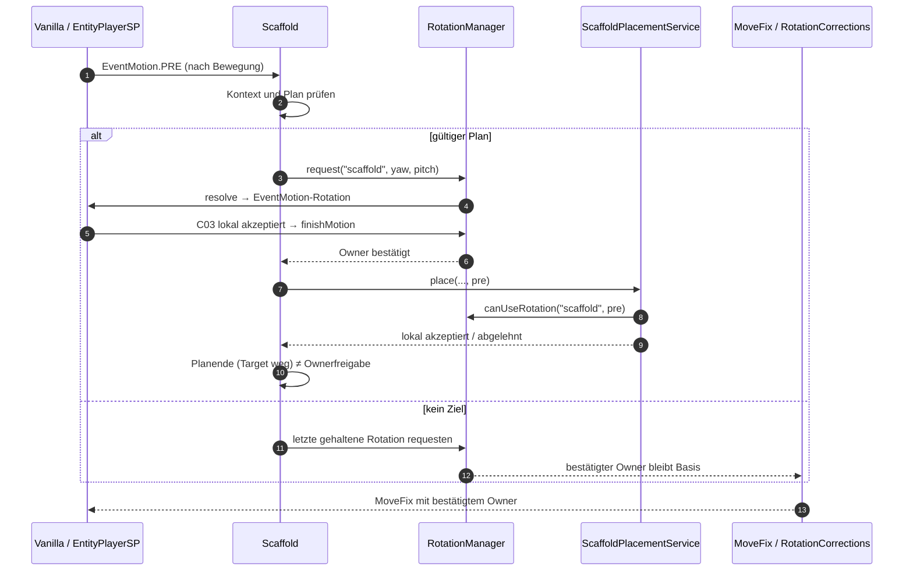
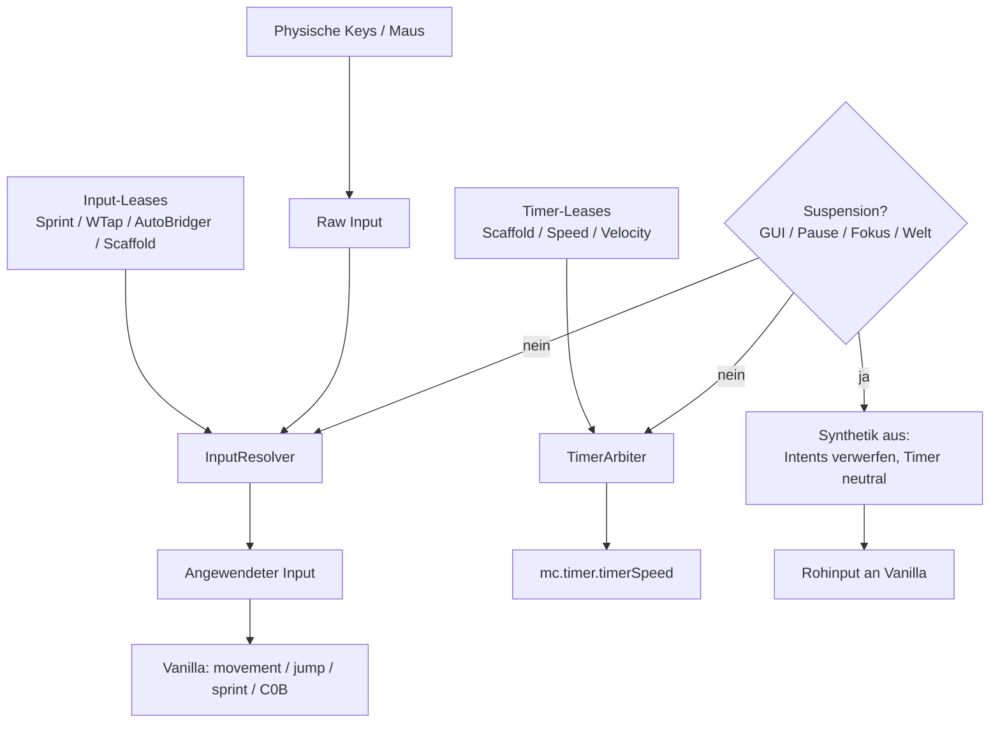
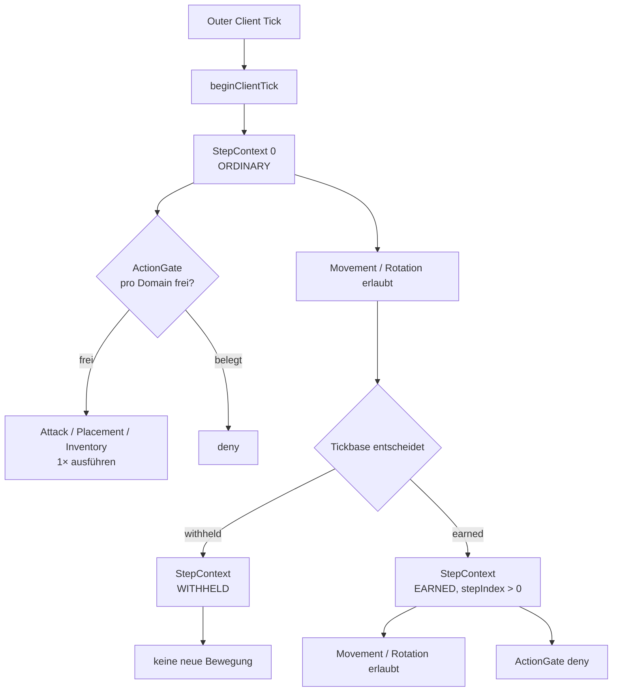

# CORE-R01 — Gemeinsame Verträge, Phasen und Schnittstellen

**Status:** Architektur-/Integrationsplanung, **keine Implementierung**  
**Datum:** 2026-10-28  
**Branch:** `prep/neutron-opencode-wave00`  
**HEAD:** `3ea55cbc34e14ad479454c6ce0d31e48e6f581fb`  
**Auftrag:** Neutron 2.0 Spezifikation v1.0 + W01-Movement-Audits in einen kleinen CORE-Vertrag überführen.

---

## 0. Ausgangslage und Arbeitsbaum

### 0.1 Git-Baseline vor CORE-R01

| Prüfung | Ergebnis |
|---|---|
| Branch | `prep/neutron-opencode-wave00` |
| HEAD | `3ea55cbc34e14ad479454c6ce0d31e48e6f581fb` |
| `git status --short` | **148 Einträge**: 147 × `M`, 1 × `?? design/opencode-wave01/` |
| `git diff --name-only` | **147 Dateien** |
| Verteilung der 147 Diffs | 145 × `test_run/**`, 1 × `.gitignore`, 1 × `.vscode/settings.json` |
| Zielverzeichnis `design/opencode-core-r01/` | vor R01 **nicht vorhanden** |
| Neue Dateien in R01 | genau die drei Berichte dieses Verzeichnisses |

Die 147 vorbestehenden Änderungen sind **fremd/vorbestehend**. Sie wurden nicht bewertet, nicht bereinigt, nicht gestaged und nicht committet. Insbesondere `test_run/saves/**` und `test_run/logs/**` werden hier nicht inhaltlich ausgewertet.

**Kurzform der dokumentierten `git status --short`-Ausgabe:**

```text
 M .gitignore
 M .vscode/settings.json
 M test_run/...                         (145 Dateien; teils gequotete Pfade)
?? design/opencode-wave01/
```

Nach dem Schreiben dieses Berichts kommt ausschließlich `?? design/opencode-core-r01/` hinzu. `git diff --name-only` muss unverändert 147 Dateien melden.

### 0.2 Java- und Maven-Stand

| Werkzeug | Feststellung |
|---|---|
| JDK 8 | `C:\Program Files\Java\jdk-1.8`, `1.8.0_391`, HotSpot 64-Bit |
| Default-`JAVA_HOME` der Shell | `C:\Program Files\Eclipse Adoptium\jdk-17.0.15.6-hotspot` |
| Maven | `3.8.5`, nur über expliziten Pfad `C:\Users\Administrator\.m2\wrapper\dists\apache-maven-3.8.5-bin\5i5jha092a3i37g0paqnfr15e0\apache-maven-3.8.5\bin\mvn.cmd` |
| Maven mit JDK 8 | `Apache Maven 3.8.5`, `Java version: 1.8.0_391`, `runtime: ...\jdk-1.8\jre` |
| Projekt | `pom.xml`: `maven.compiler.source/target = 1.8`, UTF-8, JUnit 4.13.2, Surefire 3.5.5 |
| R01-Testlauf | **keiner**. Es werden ausschließlich W00-/W01-Ergebnisse zitiert und statische Evidenz verwendet. |

### 0.3 Evidenzklassen

| Klasse | Bedeutung |
|---|---|
| **A** | im aktuellen Code statisch bestätigt |
| **B** | in W00/W01 selbst ausgeführter Test |
| **C** | Testcode gelesen, nicht neu ausgeführt |
| **D** | älterer Bericht oder dokumentiertes Ergebnis |
| **E** | nicht geprüft |

Für neue R01-Testideen gilt durchgehend **E**. R01 behauptet keine neuen Testergebnisse.

### 0.4 Gelesene Grundlagen

- Spezifikation v1.0, insbesondere §§ 3–9 und § 11.
- `design/opencode-wave01/MOV_AUDIT_W01.md`, `MOV_WRITE_ACCESS_MATRIX.md`, `MOV_HANDOFF_CORE.md`.
- `design/opencode-wave00/RESULTS.md`.
- `design/movefix-verification.md`, `design/audit-wave-1.md`, `design/audit-wave-2.md`, `design/minecraft-source-audit.md`.
- `README.md`, `pom.xml`.
- aktuelle Core-Services, Events, Module, Vanilla-Consumer und relevante Tests.

### 0.5 Abschlussprüfung nach dem Schreiben

| Prüfung | Soll | Ist |
|---|---|---|
| Branch | `prep/neutron-opencode-wave00` | unverändert |
| HEAD | `3ea55cbc34e14ad479454c6ce0d31e48e6f581fb` | unverändert |
| `git status --short` | 149 Einträge: 147 × `M`, 2 × `??` | **149**: 147 `M`, `?? design/opencode-wave01/`, `?? design/opencode-core-r01/` |
| `git diff --name-only` | 147 | **147** |
| Neue Dateien | genau 3 unter `design/opencode-core-r01/` | **3** |
| Produktions-/Test-/Build-Änderungen | 0 | **0** |

Damit ist die einzige neue Arbeitsbaum-Änderung das Berichtsverzeichnis. Die 147 vorbestehenden Diffs bleiben unangetastet.

---

## 1. Zweck, Umfang und Nicht-Ziele

### 1.1 Zweck

Dieser Vertrag legt fest, **wer** in Neutron 2.0 einen gemeinsamen Zustand besitzt, **wann** er ihn schreibt, **wie** andere Bereiche ihn anfordern und **in welcher Reihenfolge** die sieben Fachbereiche implementieren dürfen.

Er ist bewusst kleiner als ein neues Framework. Vorhandene Dienste bleiben die Basis:

- `RotationManager`, `RotationCorrections`, `MoveFixController`
- `PacketPipeline`, `PacketDelays`, `TickbaseBudget`
- `ScaffoldPlacementService`, `AttackScheduler`
- `ConfigManager`, `Module`, `Value`

### 1.2 Nicht-Ziele

- Keine Produktionsänderung, kein Testlauf, kein Branchenwechsel, kein Commit.
- Kein neuer Mixin/Hook ohne separaten Beschluss.
- Keine Änderung an `src/main`, `src/test`, `pom.xml` oder Konfigurationen.
- Keine Änderung von Speed-Werten, Scaffold-Profilen, Modusnamen oder Defaults.
- Keine Entfernung von Velocity-/NoSlow-Modi.
- Keine automatische Migration oder Umschreibung bestehender Configs.
- Keine Live-, Server-, OptiFine- oder Shader-Abnahme.

### 1.3 Verbindliche Leitplanken

1. Java 8 und Minecraft 1.8.9. Keine Records, `var`, Switch-Expressions, neuen Libraries oder Dependency-Upgrades.
2. Physische Nutzereingabe ist der Standard; Overrides nur als ausdrücklich konfigurierte, aktuell gültige Aktion.
3. Ein Zustand hat **einen** sanktionierten Schreiber. Andere Bereiche senden Requests.
4. GUI, Pause, Fokusverlust, Tod, fehlende Welt/Connection: keine neuen synthetischen Aktionen.
5. Bestehende Config-Bedeutungen und Legacy-Aliase bleiben erhalten; neue Defaults nur für neue Profile.
6. Jede Verhaltensänderung braucht einen synthetischen Test **und** eine klare Live-Abnahme, sofern sie Spielwirkung hat.

---

## 2. Ist-Phase: Was „PRE“ wirklich bedeutet

Die W01-Audits belegen: **`EventMotion.PRE` ist eine Paketphase nach der physischen Bewegung, keine Vor-Bewegungsphase.** Das ist der wichtigste Vertragspunkt, weil viele Modulnamen das Gegenteil suggerieren.

```text
Minecraft.runGameLoop
  → Timer.updateTimer
  → Tickbase.beginFrame
  → Minecraft.runTick
      → AttackScheduler.beginTick / ScaffoldPlacement.beginTick
      → TickEvent
      → Welt-/Entity-Updates
          → EntityPlayerSP.onUpdate
              → Tickbase.runPlayerStep (ordinary / withheld / earned)
                  → EventUpdate                         (vor Bewegung, ohne frischen Input)
                  → super.onUpdate()
                      → onLivingUpdate
                          → movementInput.updatePlayerMoveState()
                          → Input-/Slowdown-/Sprint-/Jump-Auswertung
                          → Entity.moveFlying / EntityLivingBase.jump
                  → onUpdateWalkingPlayer
                      → EventMotion.PRE                (nach Bewegung)
                      → Sprint-C0B / Sneak-C0B
                      → RotationManager.resolve
                      → C03 senden
                      → RotationManager.finishMotion
                      → EventMotion.POST               (nach C03)
```

### 2.1 Belegte Reihenfolge

| Punkt | Datei/Methode | Relevante Zeilen | Bedeutung |
|---|---|---|---|
| Äußerer Frame | `Minecraft.runGameLoop` | 1086–1098 | Packet-Pump, `Tickbase.beginFrame`, `runTick`-Schleife |
| Client-Tick | `Minecraft.runTick` | 1736–1737 | `AttackScheduler.beginTick`, `ScaffoldPlacement.beginTick` |
| Player-Step | `EntityPlayerSP.onUpdate` | 167–172 | `Tickbase.runPlayerStep(this, this::runLocalPlayerStep)` |
| Vor Bewegung | `EntityPlayerSP.runLocalPlayerStep` | 175–187 | `EventUpdate` (177), `super.onUpdate()` (187) |
| Input | `EntityPlayerSP.onLivingUpdate` | 864–912, 993 | Input-Sampling, Slowdown, Sprintentscheidung, `super.onLivingUpdate()` |
| Bewegung | `Entity.moveFlying` | 1126 ff. | Vanilla-Input-Transformation |
| Sprung | `EntityLivingBase.jump` | 1585 ff. | Sprungimpuls |
| Paketphase PRE | `EntityPlayerSP.onUpdateWalkingPlayer` | 222–264 | `EventMotion.PRE`, C0B, `resolve` |
| Paketphase POST | dasselbe | 275–331 | C03, `finishMotion`, `EventMotion.POST` |

**Konsequenz:** Motion-Writes in PRE wirken auf den **nächsten** Bewegungsschritt. Sprint-/Sneak-Writes in PRE wirken auf das C0B **dieses** Ticks. Key-Writes in `EventUpdate` wirken auf den Input **dieses** Ticks. Eine Vermischung dieser drei Ebenen ist der zentrale Architekturfehler.

### 2.2 Kein neuer Pre-Movement-Hook in R01

Ein echter Pre-Movement-Hook wäre ein tiefgreifender Vanilla-Eingriff. R01 empfiehlt:

- PRE/POST **bleiben Paketphasen** und werden überall so benannt.
- Ein `StepContext` beschreibt Ordinary/Withheld/Earned und den Outer-Tick.
- Kein neues `EventPreMove` und kein zusätzlicher Mixin ohne separaten Beschluss.
- Wer Bewegung dieses Ticks beeinflussen will, nutzt den Input-Boundary-Vertrag (§ 4.3), nicht PRE.

---

## 3. Gemeinsames Zustandsmodell

### 3.1 Zustände und alleinige Schreiber

| Zustand | Alleiniger Schreiber | Request-Quellen | Bestehender Consumer | Verboten |
|---|---|---|---|---|
| `timerSpeed` | **`TimerArbiter`** | SCF (Scaffold), MOV (Speed), CMB (Velocity) | `Timer.updateTimer`, `Tickbase` | direkte `mc.timer.timerSpeed`-Writes in Modulen |
| Input `forward/strafe/jump/sneak` | **`InputResolver`** | Sprint, WTap2, AutoBridger, Scaffold, Speed | `MovementInput`, `moveFlying`, `jump` | direkte `keyBind*.pressed`-Writes |
| Sprint-Status | **`InputResolver`** (ein Anwender) | Sprint, WTap2, Scaffold, MoreKB | `setSprinting`, C0B | mehrere Module rufen `setSprinting` |
| Rotation/Kamera | **`RotationManager`** + `RotationCorrections` | Aura, AimAssist, Scaffold, BridgeAssist (visible) | C03, MoveFix, Placements | direkte `rotationYaw/Pitch`-Writes in Modulen |
| Angriff | **`PlayerControllerMP` + `AttackScheduler`** | Aura | C02, `AttackEvent` | direktes C02 außerhalb des Controllers |
| Platzierung | **`ScaffoldPlacementService`** | Scaffold | `clickBlock`/Place | direkte Placement-Claims |
| Inventar | **`PlayerControllerMP` + `windowClickGuarded`** | AutoHeal | Container/C0E | direktes `windowClick` in Modulen |
| Packet-Auswahl/Transport | **`PacketPipeline` + `NetHandlerPlayClient`** | NET/Module | Netty | direkter Channel-Zugriff |
| Config | **`ConfigManager` + `Value`** | Module/UI | JSON | zweiter Config-Store |
| Körper-/Render-Pose | **`BodyRotationController`** / VIS | CMB/SCF | Renderer | Gameplay-Zustand im Renderer |

### 3.2 Ein Zustand, viele Requests, ein Schreiber

Requests sind **keine** Writes. Ein Modul darf zum Beispiel `TimerArbiter.request(...)` aufrufen, aber nicht `mc.timer.timerSpeed` setzen. Der Arbiter entscheidet, schreibt einmal und gibt ein Token zurück. Das Token ist die Identität, nicht der Wert.

### 3.3 Client-Thread und Generation

Alle neuen Verträge sind **client-thread-only**. Das ist keine neue Nebenläufigkeitsarchitektur, sondern eine Verschärfung des Ist-Zustands:

- `PacketPipeline` verarbeitet Inbound/Outbound auf dem Client-Thread; Transport-Futures sind asynchron.
- `RotationManager` bindet Player/Welt/Connection über WeakReferences und `PacketPipeline.getContextVersion()`.
- `TimerArbiter`, `InputResolver` und `MovementContext` dürfen nur aus `Minecraft.runTick`, `EntityPlayerSP`-Steps, Event-Listenern und Welt-Events heraus benutzt werden.
- Jede Lease trägt `connectionGeneration`. Ein Welt-/Session-Wechsel invalidiert sie; sie wird **nicht** in die neue Welt übertragen.

### 3.4 Die sechs Pflichtverträge A–F im Überblick

| Vertrag | Kernfrage | CORE-Antwort | Detail |
|---|---|---|---|
| **A — Eventphase / PlayerStepContext** | Wann ist Input, wann Bewegung, wann Paket? | `StepContext` mit Ordinary/Withheld/Earned, Outer-Tick, Connection-Generation; PRE bleibt Paketphase | § 2, § 4.1 |
| **B — Input-Intents** | Roh-KeyState vs. angewendeter Input; Sneak/Sprint/Jump/Forward/Strafe | `InputResolver` + `InputSnapshot`; physische Basis, TTL-Intents, keine Key-Writes | § 4.3 |
| **C — TimerLease** | Wer darf `timerSpeed` besitzen und wie wird restauriert? | `TimerArbiter` mit Token, Priorität, TTL, `before/written`, Fremdwrite-Erkennung | § 4.4 |
| **D — RotationOwner / MoveFix** | Welche Rotation ist bestätigt und wie lange? | Nur bestätigte C03-Rotation; Scaffold > Aura; Planende ≠ Ownerfreigabe; `requestVisible` für BridgeAssist | § 4.5 |
| **E — Packet / Action / Inventory** | Wer darf senden, platzieren, angreifen, klicken? | NET behält Pipeline/Delay; SCF Placement-Plan; CMB Angriff; MOD Slot/Inventar; `ActionDomain`-Gate pro Outer-Tick | § 3.1, § 6 |
| **F — Lifecycle / Persistence** | Was passiert bei Welt, Tod, GUI, Disable, Config? | Generation + Reset; keine Cross-World-Restores; Append-only-Config; Diagnose/Status pro Service | § 3.3, § 7; Datei `CORE_R01_ROLLOUT_AND_DECISIONS.md` § 5.1, § 7 |

**A–F sind keine sechs neuen Manager.** A ist ein Kontext, B/C sind je ein Domänen-Owner, D erweitert den vorhandenen `RotationManager`, E nutzt vorhandene Services, F ist eine Regel für alle.

### 3.5 Diagnose und Status (Teil von F)

Jeder neue Dienst braucht einen kleinen, abfragbaren Status, aber **kein** eigenes Log-/HUD-System:

- `TimerArbiter`: aktiver Owner, Priorität, TTL, `neutral`, `hasForeignWrite`.
- `InputResolver`: aktive Lease-Anzahl pro Kanal, aktueller Sprint-Owner, ob `suspended`.
- `MovementContext`: aktueller `clientTick`, `stepIndex`, `kind`, letzte Reset-Ursache.
- `RotationManager`: bestätigter Owner, `motionSequence`, `accepted/previousAccepted`, `suspended`.
- Config-Schema bleibt bei `ConfigManager` Version 2; neue Keys sind additiv, Migration/Legacy-Import läuft vor dem Save, bestehende Profile werden gesichert, Legacy-Aliase bleiben.
- **Legacy-Config-IDs:** vorhandene IDs/Aliase (insbesondere `Backtrack`/`Tickbase` aus W00 sowie bestehende MoveFix-/Modul-IDs) bleiben unverändert. Neue Keys sind additiv; kein Rebranding, kein stilles Umbenennen.
- **VIS-Datenübergabe (nur lesen):** `RotationSnapshot` (Owner, Yaw/Pitch, `accepted`, `motionSequence`, Scene-gültig), `ScaffoldSnapshot` (Plan aktiv, Target/Face, Fallback) und `TimerStatus` (Owner, `neutral`). VIS darf daraus Pose/HUD ableiten, aber keine Gameplay-Owner, Timer oder Inputs schreiben.
- Diagnose wird nur auf Debug-Level oder im bestehenden HUD ausgegeben; kein Paket-/Log-Spam pro Tick.
- Status ist **kein** Gameplay-Zustand und darf keine Aktionen auslösen.

---

## 4. Minimale neue Contracts (Vorschlag, nicht implementiert)

Die folgenden Skizzen sind Java-8-signaturfähig. Sie sind **Planung**, keine vorhandenen Klassen. Paketnamen sind Vorschläge und dürfen bei der Umsetzung an die bestehende Struktur angepasst werden.

### 4.1 `StepContext` — Phase, Outer-Tick, Action-Fähigkeit

```java
// VORSCHLAG — existiert nicht
public final class StepContext {
    public enum Kind { ORDINARY, WITHHELD, EARNED }

    public long clientTick();
    public int stepIndex();                 // 0 = erster Schritt des Outer-Ticks
    public Kind kind();
    public long connectionGeneration();
    public Object player();
    public Object world();

    public boolean actionEligible() {
        return stepIndex() == 0 && kind() != Kind.WITHHELD;
    }

    public boolean matches(Object player, Object world, long generation);
}
```

Regeln:

- `ORDINARY` ist der normale Schritt; `WITHHELD` ist ein zurückgehaltener Schritt; `EARNED` ist ein von Tickbase freigegebener Extra-Schritt.
- `actionEligible()` ist **nur** für den ersten Ordinary-Schritt wahr. Earned Extras dürfen Bewegung/Rotation, aber keine Angriffe/Platzierungen/Inventaraktionen auslösen.
- `matches(...)` verhindert, dass eine alte Lease nach Welt-/Spielerwechsel weiterwirkt.
- Kein `ThreadLocal`; der Kontext wird als Parameter durch `Tickbase`/`EntityPlayerSP` gereicht und über `MovementContext.currentStep()` für Listener lesbar gemacht.

### 4.2 `MovementContext` — zentrale Suspension und Action-Budget

```java
// VORSCHLAG — existiert nicht
public final class MovementContext {
    public enum ResetReason {
        WORLD, RESPAWN, DEATH, DISCONNECT, DISABLE, CONFIG, FOCUS, PAUSE
    }

    public void beginClientTick(Minecraft mc);
    public StepContext beginStep(Object player, Object world, long connectionGeneration,
                                 StepContext.Kind kind, int stepIndex);
    public void endStep(StepContext step);

    public boolean suspended();
    public boolean claim(ActionDomain domain, StepContext step);
    public StepContext currentStep();
    public void reset(ResetReason reason);
}

public enum ActionDomain { ATTACK, INVENTORY, PLACEMENT }
```

`claim(...)` ist der einzige domänenübergreifende Action-Gate:

- pro `ActionDomain` höchstens **eine** Aktion pro `clientTick`;
- nur wenn `step.actionEligible()` und `!suspended()`;
- `claim` ist idempotent ablehnend, nicht werfend;
- der Aufrufer muss die eigentliche Aktion weiterhin fachlich prüfen (Hit, Slot, Reichweite, Sequenz).

Der Gate ersetzt **nicht** `AttackScheduler` oder das Placement-Budget. Er verhindert nur, dass Tickbase-Extras oder mehrere Steps pro Outer-Tick dieselbe Aktion mehrfach auslösen.

### 4.3 `InputResolver` — physischer Input plus befristete Intents

```java
// VORSCHLAG — existiert nicht
public final class InputResolver {
    public enum Channel { FORWARD, BACK, LEFT, RIGHT, JUMP, SNEAK, SPRINT }

    public InputLease request(String owner, int priority, Channel channel,
                              boolean pressed, int ttlTicks, StepContext step);
    public boolean renew(InputLease lease, int ttlTicks, StepContext step);
    public void release(InputLease lease);

    public InputSnapshot resolve(InputSnapshot raw, StepContext step);
    public void reset(ResetReason reason);
}

public final class InputLease {
    public long token();
    public String owner();
    public Channel channel();
}

public final class InputSnapshot {
    public float rawForward();
    public float rawStrafe();
    public boolean rawJump();
    public boolean rawSneak();
    public boolean rawSprint();

    public float forward();
    public float strafe();
    public boolean jump();
    public boolean sneak();
    public boolean sprint();

    public String sprintOwner(); // null = physisch/Vanilla
}
```

Regeln:

- `raw*` wird aus dem aktuellen `MovementInput` nach `updatePlayerMoveState()` gelesen.
- `InputResolver` schreibt **keine** `KeyBinding.pressed`-Felder. Er liefert den angewendeten Snapshot; ein einziger Adapter setzt ihn am definierten Ort in `movementInput`/`setSprinting`.
- Physischer Input ist die Basis. Ein Intent gilt nur, solange er aktiv ist, `ttlTicks > 0` hat und der Kontext gültig ist.
- Prioritäten sind fachlich zu setzen, nicht als globale Magie. Vorschlag:
  - physischer Stop/Sneak: Basis und nicht überschreibbar durch Sprint-Start;
  - Scaffold-Sprint-Stop: nur solange ein gültiger Plan existiert;
  - WTap-Stop: TTL 1–2 Ticks;
  - Sprint-Fallback: nur wenn kein Stop-Intent aktiv ist;
  - Jump: physischer Sprung vor Modul-Jump; höchstens ein Jump pro Step.
- `ttlTicks` zählt in Client-Ticks, nicht in Millisekunden. WTap2s bisherige `durationMs` wird nur für die Config-Anzeige beibehalten oder sauber migriert; die Autorität ist der Tick.
- Bei GUI/Pause/Fokusverlust werden **keine** Intents angewendet. Synthetische Leases werden verworfen; nach Resume müssen Module neu anfordern.
- Bei Release wird der physische Zustand neu gelesen, niemals pauschal `false` geschrieben.

### 4.4 `TimerArbiter` — Token statt Wertvergleich

```java
// VORSCHLAG — existiert nicht
public final class TimerArbiter {
    public TimerLease request(String owner, int priority, float speed,
                              int ttlTicks, StepContext step);
    public boolean renew(TimerLease lease, float speed, int ttlTicks, StepContext step);
    public void release(TimerLease lease);

    public void resolve(StepContext step); // einziger Schreibpunkt
    public boolean isNeutral();
    public boolean hasForeignWrite();
    public void suspend();
    public void reset(ResetReason reason);
}

public final class TimerLease {
    public long token();
    public String owner();
    public int priority();
    public int ttlTicks();
}
```

Regeln:

- Der Arbiter ist der **einzige** sanktionierte Schreiber von `mc.timer.timerSpeed`.
- `request` erzeugt immer ein neues Token, auch wenn `desired == current`. Damit ist „gleicher Wert, anderer Owner“ eindeutig.
- Prioritäten (Vorschlag, noch nicht implementiert): `Scaffold 80 > Speed 60 > Velocity 40`. Gleichstand wird deterministisch (älteres Token gewinnt) aufgelöst; kein Modul darf sich selbst hochstufen.
- `before` wird beim ersten aktiven Lease gespeichert. `release` stellt `before` nur wieder her, wenn `current == written` und keine höhere Lease aktiv ist.
- Fremder Write (`current != written`) invalidiert alle Leases, ohne zurückzuschreiben. Ein fremder Write mit **gleichem** Wert ist technisch nicht erkennbar; das ist ein dokumentierter Rest-Risiko-Fall. Token verhindern trotzdem, dass ein eigener Release fremden Besitz überschreibt.
- `resolve` läuft an **einem** stabilen Punkt pro Outer-Tick, bevor `Timer.updateTimer` den nächsten Frame beeinflusst. Vorschlag: `Minecraft.runTick` direkt nach `beginTick`, vor `TickEvent`.
- `suspend` gibt alle Leases frei und stellt – nur bei sicherem eigenem Write – den vorherigen Wert wieder her. `reset` stellt **nie** über Welt-/Session-Grenzen wieder her.
- `Tickbase` prüft künftig `timerArbiter.isNeutral()` statt `abs(timerSpeed-1) < .001`. Ein aktiver Lease mit Wert 1.0 ist **nicht** neutral.

### 4.5 Rotation: Erweiterung des vorhandenen `RotationManager`

Kein neuer Rotationsmanager. Ergänzt werden nur source-spezifische Prädikate und ein Plan-/Owner-Schnitt:

```java
// VORSCHLAG — Erweiterung der bestehenden Klasse
public boolean canUseRotation(String source, boolean pre);
public String confirmedOwner(boolean pre);
public void resetTrajectory(String source); // Planende, nicht Ownerfreigabe
public void suspend();                      // GUI/Pause: keine Anwendung
```

Regeln:

- `canUseRotation(source, pre)` ist nur wahr, wenn `source` der **bestätigte** Owner ist, die passende Akzeptanz (`previousAccepted` für PRE, `accepted` für POST) vorliegt und der Kontext nicht suspendiert ist.
- `getConfirmedOwner()` und `canUseRotation(...)` müssen dieselbe Predicate verwenden. Das heutige `canUseRotation(boolean)` ohne Owner-Prüfung ist für Produktionsconsumer zu schwach.
- `finishMotion` bestätigt einen Owner nur bei einem tatsächlich gesendeten/akzeptierten C03 und exakter Winkelübereinstimmung. Ein abgelehnter, ersetzter oder nicht gesendeter Frame bestätigt nichts.
- Planende (`resetTrajectory("scaffold")`) löscht Target/Trajektorie, aber **nicht** den bestätigten Owner. Ownerfreigabe ist ein separater Vorgang.
- Scaffold hält seine letzte akzeptierte Rotation als eigenen Wunschzustand und requestet sie weiter, solange es logisch aktiv ist. So bleibt die MoveFix-Basis erhalten, auch wenn gerade kein Platzierungsziel existiert.
- Disable: sichtbare Rückführung über 2–4 Ticks (Vorschlag, freigabepflichtig), danach `releaseOwner`; Weltwechsel/Death/Disconnect: harter Reset ohne Smoothing.
- `BridgeAssist` schreibt die Kamera nicht mehr direkt, sondern nutzt `requestVisible` mit eigener Priorität und PRE-only-Gültigkeit.
- `RotationCorrections` bleibt der einzige Konsumenten-Adapter und prüft weiterhin GUI/Fokus/RenderViewEntity.
- **Reentranz:** Während `resolve`, C03-Transport und `finishMotion` dürfen Listener keine neue Rotation in denselben Frame einfügen. Ein Request nach `finishMotion` gilt für die nächste `motionSequence`; `reset`/`suspend` dürfen nicht rekursiv `resolve` auslösen. Ein verschachtelter Request wird verworfen und diagnostiziert, nicht still übernommen.
- **Szenenwechsel:** `bindConnection`/`beginMotion` prüfen Player, Welt und Connection-Generation. Ein neuer Kontext startet ohne alten Owner, ohne alte Trajektorie und ohne altes `previousAccepted`.

---

## 5. Bestehende API → minimale Änderung

| Bestehende API | Beleg | Minimale Änderung | Neuer Owner | Ausdrücklich verboten |
|---|---|---|---|---|
| `EventUpdate` / `EventMotion` / `TickEvent` / `EventPacket` | Events, `EntityPlayerSP` 176–177, 222, 330 | Keine neuen Events; `StepContext` über `MovementContext` bereitstellen | CORE | Neues Pre-Move-Event ohne Beschluss |
| `EntityPlayerSP.runLocalPlayerStep` | 175–187 | Step-Kontext öffnen/schließen; keine Phasenverschiebung | CORE/MOV | Zweiter Player-Tick |
| `EntityPlayerSP.onLivingUpdate` | 864–912, 993 | Input-Snapshot nach 868, Intent-Anwendung vor Bewegung/Sprint/C0B | MOV | Key-Writes in Modulen |
| `RotationManager` | 48–134, 297–316 | `canUseRotation(String, pre)`, `resetTrajectory`, `suspend`; Ownerbestätigung schärfen | CMB | Zweiter RotationManager; `reset(String)` als Planende |
| `RotationCorrections` | 61–65, 75–79 | Source-spezifische Predicate; keine Kamera-Writes | CMB | Direkte `rotationYaw/Pitch`-Writes |
| `MoveFixController` | 28–48 | Unverändert; konsumiert bestätigten Owner und angewendeten Input | CMB | Formel „reparieren“, obwohl W01 sie bestätigt |
| `ScaffoldPlacementService` | 208–244 | Source-spezifische Rotationsprüfung; `ActionDomain.PLACEMENT` beanspruchen | SCF | Zweiter Placement-Manager |
| `Scaffold` | 127–135, 144–198, 232–244 | Planende von Ownerfreigabe trennen; Timer-Lease; Input-Intent; kein `reset("scaffold")` pro Platzierung | SCF | Owner pro Platzierung freigeben |
| `PacketPipeline` / `PacketDelays` | 55–100 | Unverändert; Owner-/Delay-Semantik bleibt | NET | Zweite Queue oder zweiter Pipeline-Manager |
| `Tickbase` / `TickbaseBudget` | 74–130; 31–67 | `StepContext`/ActionGate; `isNeutral`; Extra-Steps ohne Doppelaktion | NET | Zweites Tick-/Budget-System |
| `Timer` | 90–150 | `timerSpeed` bleibt Feld; nur `TimerArbiter` schreibt | CORE | Direkte Writes in Modulen |
| `MovementInput` | statische Felder | Snapshot jetzt; Instanzfelder erst als separate Welle | MOV | Sofortige breite Vanilla-Änderung |
| `ConfigManager` / `MoveFixValue` | Version 2, `decodeConfig` | Append-only Defaults/Migration; Legacy-Werte erhalten | MOD | Zweiter Config-Manager; stille Umschreibung |
| `ModuleManager` / `Module` | Key-Handling | Konflikt-Warnung/Default-Hygiene; keine stillen Rebinds | MOD | Neuer Key-Manager |
| `BodyRotationController` / VIS | 1–101, Renderer | Read-only Pose; keine Gameplay-Owner | VIS | Rotation im Renderer „korrigieren“ |
| `ClientRuntime` / `RuntimeServices` | 13–17, 30 ff. | Neue Services einmal instanziieren; Fallbacks nicht erweitern | CORE | Statische Parallel-Singletons |

### 5.1 Pflichtmatrix: API → Änderung → Owner → Consumer → Phase → Reset → Tests

| Bestehende API | Minimale Änderung / ergänzende API | Owner | Consumer | Thread/Phase | Reset/Fehlerfall | Tests |
|---|---|---|---|---|---|---|
| `EventUpdate`/`EventMotion`/`TickEvent`/`EventPacket` | Keine neuen Events; `MovementContext.currentStep()` bereitstellen | CORE | alle Movement-/Rotation-/Packet-Listener | Client-Thread; Update/PRE/POST | Kontext ungültig ⇒ kein neuer Step | `PlayerStepHookTest`, `StepContextTest` |
| `EntityPlayerSP.runLocalPlayerStep` | `beginStep`/`endStep` um den bestehenden Ablauf | CORE/MOV | `Tickbase`, Module | Client-Thread; Outer-Tick/Step | Welt/Death/Disconnect ⇒ `reset` | `PlayerStepHookTest`, `MinecraftWorldLifecycleTest` |
| `EntityPlayerSP.onLivingUpdate` | Snapshot nach `updatePlayerMoveState`; Intent-Apply vor Bewegung/Sprint | MOV | Vanilla-Input, `moveFlying`, `jump` | Input-Boundary; vor `super.onLivingUpdate` | GUI/Pause ⇒ Rohinput, keine Intents | `InputResolverTest`, `SprintOrderingTest` |
| `RotationManager` | `canUseRotation(String, pre)`, `confirmedOwner`, `resetTrajectory`, `suspend` | CMB | `RotationCorrections`, Placement, MoveFix | Client-Thread; PRE/POST | Scene/Disable/Welt ⇒ Owner reset | `RotationBehaviorHookTest`, `RotationOwnerContinuityTest` |
| `RotationCorrections` | source-spezifische Predicate; keine direkten Kamera-Writes | CMB | `PlayerMoveUpdateEvent`, Renderer | PRE/POST | GUI/Fokus ⇒ keine Anwendung | `RotationCorrectionsTest`, `NetworkMoveFixIntegrationTest` |
| `MoveFixController` | unverändert; Input + bestätigter Owner als Eingabe | CMB | `PlayerMoveUpdateEvent` | Input-Boundary/PRE | kein Owner ⇒ keine Korrektur | `MoveFixProductionTest`, `MoveFixControllerTest` |
| `ScaffoldPlacementService` | `canUseRotation("scaffold", pre)`, `ActionDomain.PLACEMENT` | SCF | `Scaffold` | PRE/POST | Plan/Welt/Stack ⇒ `Rejection` | `ScaffoldPlacementTest`, `ScaffoldClientFlowTest` |
| `Scaffold` | Planende/Ownerfreigabe trennen; Timer-/Input-Requests | SCF | Placement, Rotation, MoveFix | PRE/POST/Tick | Zielverlust/Disable/Welt getrennt | `RotationOwnerContinuityTest`, `ScaffoldNetworkIntegrationTest` |
| `PacketPipeline`/`PacketDelays` | unverändert; sechs Zustände dokumentieren | NET | Module, `NetHandlerPlayClient` | Outbound/Inbound; POST | `close`/`discard` ⇒ keine Aktion | `PacketFlowTest`, `PacketDelayTest`, `NetworkShutdownTest` |
| `Tickbase`/`TickbaseBudget` | `StepContext`, `ActionGate`, `timerArbiter.isNeutral()` | NET | `EntityPlayerSP`, Module | Client-Tick/Step | ungesunder Frame ⇒ reset | `TickbaseBehaviorHookTest`, `TickbaseBudgetTest` |
| `Timer` | `timerSpeed` bleibt Feld; nur `TimerArbiter.resolve` schreibt | CORE | `Timer.updateTimer`, Tickbase | Frame/Tick | Suspend/Welt ⇒ neutral/reset | `TimerArbiterTest`, `TickbaseBudgetTest` |
| `MovementInput` | Snapshot jetzt; Instanzfelder separat | MOV | Vanilla, MoveFix, Module | Input-Boundary | Snapshot pro Step; kein statischer Rest | `MovementInputContractTest` |
| `ConfigManager`/`MoveFixValue` | additive Defaults, Legacy-Import, Backup | MOD | Module/UI | Config-Load/Save | Fehler ⇒ altes Profil behalten | `LegacyModuleConfigTest`, `ConfigManagerTest` |
| `ModuleManager`/`Module` | Key-Konflikt-Warnung, Default-Hygiene | MOD | UI/Keybindings | Toggle/Load | Konflikt ⇒ Warnung, kein Rebind | `ModuleManagerTest` |
| `BodyRotationController`/VIS | read-only Pose, Diagnose | VIS | Renderer | Render | Scene-Reset | `BodyRotationControllerTest`, `MotionRenderCheck` |
| `ClientRuntime`/`RuntimeServices` | Services einmal instanziieren | CORE | alle Module | Startup/Reset | doppelte Instanz ⇒ Fehler | `ConfigManagerTest`, `MovementContextTest` |

---

## 6. Konkrete Verbraucher und Erreichbarkeit

Die folgenden Ketten belegen, dass die Contracts an tatsächlich erreichbaren Stellen andocken, ohne neue Vanilla-Hooks zu erfinden.

| Contract | Erreichbarer Hook | Beleg | Warum ausreichend |
|---|---|---|---|
| `MovementContext.beginClientTick` | `Minecraft.runTick` | 1736–1737 | direkter Nachbar von `AttackScheduler`/`ScaffoldPlacement` |
| `StepContext` | `EntityPlayerSP.onUpdate` → `Tickbase.runPlayerStep` | 167–172 | jeder lokale Schritt läuft hier durch |
| `SuspensionGate` | `Minecraft.displayGuiScreen`, `setIngameNotInFocus`, `currentScreen`, `isGamePaused` | 952–980, 1456–1463 | GUI/Fokus sind zentral sichtbar |
| `InputSnapshot` | `onLivingUpdate` nach `updatePlayerMoveState` | 864–869 | Vanilla-Input ist frisch und noch nicht in Bewegung umgesetzt |
| `InputResolver` Apply | `onLivingUpdate` vor `super.onLivingUpdate` | 912–993 | Bewegung, Jump und Sprintentscheidung folgen danach |
| `Sprint-C0B` | `onUpdateWalkingPlayer` | 230–240 | Sprintstatus wird hier als Packet gespiegelt |
| `RotationManager.resolve` | `onUpdateWalkingPlayer` | 264 | vor C03 und vor `finishMotion` |
| `Placement` | `Scaffold.onMotionEvent` → `ScaffoldPlacementService.place` | 175, 183, 239; 209–244 | genau ein Controller-Versuch pro Motion-Sequenz |
| `Attack` | `PlayerControllerMP.tryAttackEntity` | 534–571 | einziger sanktionierter Angriffsweg |
| `Inventory` | `PlayerControllerMP.windowClickGuarded` | 607–622 | geprüfter Slot-/Container-Pfad |
| `Packet` | `NetworkManager.sendPacketTracked`/`sendPacketGuarded` | 247–256 | Pipeline ist vorgeschaltet |
| `Timer` | `Minecraft.runGameLoop`/`Timer.updateTimer` | 1091–1092; `Timer` 90–150 | Timer wird jeden Frame gelesen |
| `Config` | `ConfigManager`, `MoveFixValue.decodeConfig` | Version 2; 16–20 | bestehende Migration bleibt zuständig |

### 6.1 MOV-W01-001…018 — Kurzdisposition

Die vollständige Matrix mit Evidenz, Welle und Testzuordnung liegt in `CORE_R01_INTEGRATION_TEST_MATRIX.md` § 2. Hier die CORE-Kurzfassung:

| Finding | W01-Status | Paket | CORE-Auflösung |
|---|---|---|---|
| **001** PRE ist Nach-Bewegung | bestätigt (Code); nicht geprüft (Live) | CORE | `StepContext`; PRE bleibt Paketphase |
| **002** fehlender GUI-/Fokus-Guard | bestätigt (Code); nicht geprüft (Live) | CORE/MOV | zentrale Suspension |
| **003** Timer ohne Owner | bestätigt (Code); nicht geprüft (Interleaving) | CORE/MOV/CMB | `TimerArbiter` |
| **004** Scaffold-Owner pro Platzierung | bestätigt (Code); nicht geprüft (Spielwirkung) | SCF/CMB | Plan/Owner-Trennung |
| **005** Speed-Basis/Potion | bestätigt (Code/Test); nicht geprüft (Server) | MOV | D4/G-CMB-SPEED, keine Auto-Änderung |
| **006** Sprint-Besitz | bestätigt (Code/Test); nicht geprüft (Kombination) | MOV/CORE | `InputResolver` |
| **007** AutoBridger/G-Kollision | bestätigt (Code); nicht geprüft (Live) | MOV/MOD | Sneak-Lease, Key-Konflikt |
| **008** BridgeAssist umgeht Manager | bestätigt (Code); nicht geprüft (Kamera) | SCF/CMB | `requestVisible` |
| **009** Velocity-Modi/Chance | bestätigt (Code); Hypothese (Spielwirkung) | MOV | Modus-Disposition, kein Auto-Remove |
| **010** MoreKB C0B/Target | bestätigt (Code); nicht geprüft (Server) | MOV/NET | Packet-/Input-Vertrag |
| **011** NoSlow-Default/Modi | bestätigt (Code/Test); nicht geprüft (Paket) | MOV | D8, kein Defaultwechsel |
| **012** statisches MovementInput | bestätigt (Code); nicht geprüft (Fehlfunktion) | MOV | Snapshot, Instanz später |
| **013** fehlende Welt-Resets | bestätigt (Code); nicht geprüft (Live) | CORE/MOV | Lifecycle/Generation |
| **014** Tickbase-Doppelaktionen | bestätigt (Code/Test); nicht geprüft (Kombination) | NET/CORE | StepContext + ActionGate |
| **015** Scaffold-MoveFix „Aus“ | bestätigt (Code/Spec); nicht geprüft (Nutzerwirkung) | MOD/SCF | neue Profile „Präzise“, Migration offen |
| **016** JumpReset-Kollision | bestätigt (Code); nicht geprüft (Live) | MOV | Jump-Intent, ein Jump/Step |
| **017** toter Code | bestätigt (Code) | MOV/SCF | erst nach Migration |
| **018** Paketspam/Namen | bestätigt (Code); nicht geprüft (Live) | NET/MOD | Trace, Namensdoku |

**Legende:** „Live E“/„Server E“ bedeutet **nicht geprüft**; es ist keine Abwertung der Code-Evidenz.

### 6.2 Wichtige Ist-Details, die der Vertrag nicht verwischen darf

- `RotationManager.reset(String)` entfernt den State und den Owner, lässt aber `hasEffective`, `accepted` und `previousAccepted` stehen. Deshalb kann `canUseRotation(true)` nach einem Scaffold-Reset weiterhin `true` liefern, obwohl `owner == null`. Source-spezifische Predicate sind Pflicht.
- `Scaffold.releasePlacement()` ruft heute `RotationManager.reset("scaffold")` nach jeder Platzierung und bei Zielverlust auf. Das ist der belegte Spec-3.1-Verstoß.
- `Scaffold.TimerControl.apply` erwirbt keinen Besitz, wenn `current == desired`; `release` kann dann nichts wiederherstellen. Genau dieser Fall wird durch `TimerArbiter`-Token gelöst.
- `Scaffold` schreibt `setSprinting(false)` und optional `jump()` direkt in PRE; `WTap2`, `Sprint`, `AutoBridger` schreiben Keys/Sprint direkt. Der Input-Vertrag ersetzt diese Writes durch Requests.
- `BridgeAssist.performGlide` schreibt `rotationYaw/Pitch` direkt (95–119), `aimAt` ist public und ungeprüft. Der Vertrag verlangt `requestVisible`.
- `Velocity` und `Speed` schreiben `mc.timer.timerSpeed` direkt; `Tickbase` hängt an `abs(timerSpeed-1)`. Das wird durch `TimerArbiter` und `isNeutral()` ersetzt.
- `MovementInput.moveForward/moveStrafe` sind statisch; mehrere Tests resetten sie bereits. R01 ändert das nicht sofort.

---

## 7. Fehler- und Invalidierungsvertrag

| Situation | Timer | Input | Rotation | Aktionen |
|---|---|---|---|---|
| `currentScreen != null` / `!inGameHasFocus` | Leases freigeben, neutral | keine Intents anwenden, Leases verwerfen | keine neuen Requests; bestätigter Owner wird nicht angewendet | keine |
| `isGamePaused` | wie GUI | wie GUI | keine Anwendung | keine |
| Spieler tot | reset | reset | reset | keine |
| Weltwechsel / Respawn | reset, kein Restore über Weltgrenze | reset | reset, kein Smoothing | keine |
| Disconnect / Connection-Wechsel | reset | reset | `invalidateConnection`/reset | keine |
| Modul-Disable | Lease freigeben; Restore nur bei eigenem Write | Lease freigeben; physischen Input neu lesen | 2–4 Tick Smoothing, dann Owner frei | keine neuen Aktionen |
| Fremder Timer-Write | Leases invalidieren, nicht kämpfen | unverändert | unverändert | unverändert |
| Gleicher Timer-Wert, anderer Owner | Token bleibt unterscheidbar | – | – | – |
| Abgelehnter/ersetzter C03 | – | – | kein Owner bestätigt | Placement verweigert |
| Doppelter Action-Request | – | – | – | zweiter `claim` wird abgelehnt |
| Veraltete Generation | Lease ungültig | Lease ungültig | Owner ungültig | keine |

**Fail-closed-Regel:** Bei fehlender Gewissheit wird **nicht** geschrieben. Ein nicht bestätigter Owner, eine abgelaufene Lease oder ein ungültiger Kontext führen zu keiner Aktion, nicht zu einer „besten Schätzung“.

---

### 7.1 Packet-Lebenszyklus (Vertrag E)

Die sechs Zustände dürfen nicht zu einem „gesendet“ verschmelzen:

| Zustand | Bedeutung | Wer beobachtet ihn? | Keine Aussage über |
|---|---|---|---|
| **Requested** | Modul möchte senden/platzieren/angreifen | Modul | Auswahl, Transport, Server |
| **Selected** | Pipeline/Controller wählt konkreten Pfad | `PacketPipeline`/`PlayerControllerMP` | tatsächlichen Versand |
| **Held** | Delay/Queue hält den Request | `PacketDelays` | lokale Akzeptanz |
| **Locally Accepted Outbound** | lokaler Transport hat das Paket angenommen | `PacketPipeline`-POST, Controller | Serverempfang |
| **Applied Inbound** | Client-Handler hat ein Inbound-Paket angewendet | `PacketPipeline.inbound` | serverseitige Bestätigung |
| **Server Confirmed** | nur durch Server-/Spielzustand belegbar | Live-Test/Server | keine Client-Garantie |

Regeln:

- `RotationManager.finishMotion` bestätigt einen Owner nur bei **lokal akzeptiertem** C03, nicht bei „Requested“.
- `ScaffoldPlacementService.place` bestätigt nur den lokalen Controller-Erfolg; der Server kann später ablehnen.
- `AttackScheduler`/`PlayerControllerMP` bestätigen nur den lokal akzeptierten C02-Pfad; kein „Hit“ ohne `currentHit`.
- `PacketDelays.release`/`close` dürfen keine neue Gameplay-Aktion auslösen.
- Ein Test, der „Server Confirmed“ behauptet, ist nur ein Live-Test (R2), kein JUnit-Fall.

### 7.2 Mindestens zwei Konfliktszenarien pro Vertrag

| Vertrag | Konflikt 1 | Konflikt 2 |
|---|---|---|
| **A — Phase/Step** | Ein Modul behandelt PRE als „vor Bewegung“ und schiebt Motion-Writes einen Tick zu spät. | Ein Weltwechsel tritt zwischen Ordinary Step und Earned Step auf; alte Generation darf nicht weiterlaufen. |
| **B — Input** | Physischer Sneak wird von AutoBridger überschrieben; nach Disable bleibt `pressed=false`. | Sprint-Start will laufen, WTap/Scaffold wollen stoppen; Reihenfolge und TTL müssen entscheiden. |
| **C — Timer** | Speed und Scaffold halten beide 1.0; wertbasierter Release verliert den Owner. | Fremder Write setzt 1.7, während die Lease 1.5 schrieb; blindes Restore würde den Fremdwrite zerstören. |
| **D — Rotation** | Scaffold verliert das Ziel, Aura requestet gleichzeitig; Aura darf den bestätigten Owner nicht erben. | C03 wird verworfen/ersetzt; ein alter effektiver Winkel darf nicht als neuer Owner gelten. |
| **E — Action/Packet** | Tickbase-Extra und Aura lösen im selben Outer-Tick zwei C02 aus. | Scaffold-Platzierung und Inventar-Slotwechsel überlappen; Slot-Restore darf keine zweite Aktion auslösen. |
| **F — Lifecycle** | GUI öffnet während Scaffold-Timer und Rotation; beides darf nicht weiter synthetisch wirken. | Disconnect mit gehaltener Lease; `close`/`discard` darf nicht in eine neue Session restaurieren. |

---

## 8. Keine konkurrierenden Manager

Der Vertrag erlaubt genau die folgenden Zuständigkeiten:

| Domäne | Bestehend | Neu/Erweiterung | Darf nicht entstehen |
|---|---|---|---|
| Input | Vanilla `MovementInput` | `InputResolver` + Snapshot | zweiter Key-/Input-Manager |
| Timer | Vanilla `Timer` | `TimerArbiter` | zweiter Timer, Delta-Budget als Parallelsystem |
| Rotation | `RotationManager` + `RotationCorrections` | source-spezifische Predicate, `suspend` | zweiter Rotationsmanager, Kamera-Writer |
| Packet | `PacketPipeline`, `PacketDelays`, `NetworkManager` | Action-Gate im CORE | zweite Queue, zweiter Sendepfad |
| Config | `ConfigManager`, `Module`, `Value` | neue Defaults/Migration | zweiter Config-Store |
| Actions | `AttackScheduler`, `ScaffoldPlacementService`, `PlayerControllerMP` | `ActionDomain`-Gate | zweiter Attack-/Placement-Scheduler |
| Render | `BodyRotationController`, `UiEffects` | VIS-Pose/Diagnose | Gameplay-State im Renderer |

`MovementContext` ist bewusst **kein** Manager für Bewegung. Es hält nur den aktuellen Step, die Suspension und das Action-Budget. Die fachliche Bewegung bleibt in Vanilla, `MoveFixController`, `Speed` und den Modulen.

---

## 9. Mermaid-Diagramme

### 9.1 Rotation / Scaffold-Placement



### 9.2 Input- und Timer-Arbitration



### 9.3 Tickbase und Action-Once



---

## 10. Abnahmekriterien für diesen Vertrag

Ein späterer Implementierungs-PR erfüllt den CORE-Vertrag nur, wenn alle Punkte belegt sind:

1. `StepContext` wird für jeden lokalen Schritt erzeugt; `Kind` und `stepIndex` sind testbar.
2. `ActionDomain`-Gate verhindert Doppelaktionen über Ordinary/Withheld/Earned und über PRE/POST.
3. `InputResolver` ist der einzige Modul-Schreiber von Input-Intents; kein Modul schreibt `keyBind*.pressed`.
4. `TimerArbiter` ist der einzige Schreiber von `mc.timer.timerSpeed`; `Tickbase` nutzt `isNeutral()`.
5. `canUseRotation(String, pre)` wird von Placement und MoveFix verwendet; `reset(String)` ist kein Planende mehr.
6. Scaffold hält seinen Rotationswunsch über Platzierungen und Zielverluste; Planende ≠ Ownerfreigabe.
7. Welt-/Death-/Disconnect-Reset invalidiert alle Leases und stellt nichts über die Grenze wieder her.
8. GUI/Pause/Fokus verhindern synthetische Aktionen, Timer und Input; logische Scaffold-Ziele bleiben erhalten.
9. Bestehende Configs und Legacy-Aliase bleiben lesbar; neue Defaults nur für neue Profile.
10. Kein neuer Input-, Timer-, Rotations-, Packet- oder Config-Manager; keine Dependency-Änderung; Java 8 bleibt buildbar.
11. Die volle bestehende Suite bleibt grün; neue Tests decken die Verträge ab (siehe `CORE_R01_INTEGRATION_TEST_MATRIX.md`).
12. Die numerischen Gates `G-CMB-SPEED` (4 Werte) und `G-SCF-ANGLES` (8 Profile) bleiben bis zur Nutzerfreigabe blockiert.

---

## 11. Kurzfazit

Der kleinste tragfähige CORE-Vertrag ist: **ein Step-Kontext, ein Input-Resolver, ein Timer-Arbiter, eine geschärfte Rotation-Owner-Predicate und ein domänenübergreifendes Action-Gate.** Alles andere bleibt bei den vorhandenen Diensten. Die drei größten Konflikte sind die PRE/Nach-Bewegung-Semantik, der Timer ohne Token-Owner und der Scaffold-Rotations-Reset nach jeder Platzierung.
